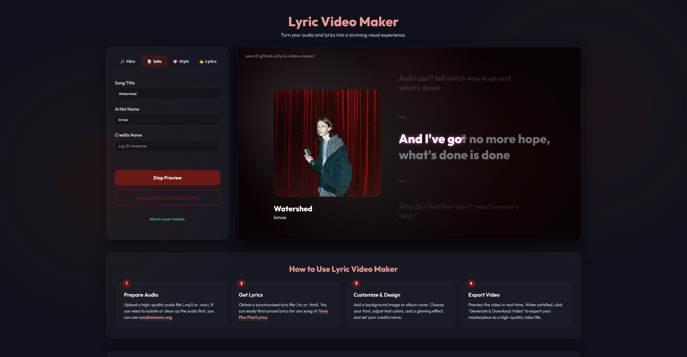

# 🎵 Lyric Video Maker (v2.0.0)

> Create gorgeous synced lyric videos from your audio and lyrics files directly in your browser.

> 🌐 **Live Web App:** [https://zexerif.github.io/lyric-video-maker/](https://zexerif.github.io/lyric-video-maker/)

**Lyric Video Maker** is a browser-based suite to generate lyric videos from synchronized lyrics (`.lrc` or word-by-word `.ttml` files) and audio tracks (`.mp3`, `.wav`, `.flac`, `.m4a`). It runs 100% locally on the client side, letting you customize typography, animations, background visuals, and export high-definition WebM/MP4 videos securely in your browser.

---

## 🎉 What's New in v2.0.0

- ✍️ **Interactive Lyric Studio & Tap-to-Sync**:
  - Fullscreen visual timeline editor with audio waveform scrubbing and live playhead seeking.
  - Interactive line & word editing with +/- 50ms and +/- 200ms fine-tuning nudges.
  - **Tap-to-Sync**: Tap <kbd>Space</kbd> as music plays to stamp real-time synchronization on any lyric line.
- 🎤 **Apple Music-Style Backing Vocals & Overlapping Vocal Sync**:
  - Secondary vocal typography rendered at 73% font size with styled or normal rendering.
  - **Overlapping Vocal Playback Setting**: When backing vocals or ad-libs occur during a main vocal line, displays them alongside the active melody rather than prematurely skipping ahead.
- 🌐 **Dual-Language & Sub-Lyrics Support**:
  - Auto-detects dual-language pairs separated by `//`, `///`, `|`, or consecutive timestamps.
  - Renders translations or romaji subtitles directly underneath main lyric lines with configurable display options.
- 🎨 **One-Click Curated Style Presets**:
  - Instant aesthetic switching: *Apple Music*, *Spotify Canvas*, and *Minimalist Modern*.
- ↶ **Global Undo & Redo (`Ctrl+Z` / `Ctrl+Y`)**:
  - Dedicated history stack tracking style adjustments, editor changes, and preset selections.
- ⌨️ **Comprehensive Keyboard Shortcuts**:
  - Full keyboard transport control (`Space`, arrow navigation, `Ctrl+Z`, `Ctrl+Y`, `Ctrl+S`, `Ctrl+O`, `L` for Studio, `?` for cheat-sheet).
- ⚡ **Audio-Reactive Visuals**:
  - Web Audio API real-time frequency analysis driving dynamic background glows, pulsing artwork bass beats, or glowing spectrum bars.
- 🔍 **iTunes Search & High-Res Artwork Auto-Fill**:
  - Search any track on iTunes to auto-fill title, artist, key, BPM, and high-resolution cover art.
- 📥 **Integrated Synced Lyrics Search**:
  - Query LyricsPlus and LRCLIB directly to retrieve timed LRC/TTML lyrics in one click.
- 📱 **Streamlined UI & Zero-Overflow Layout**:
  - 2x2 media rack, uniform 38px pill button aesthetic, and adaptive layout that fits cleanly across all screen sizes.
- 🧩 **Modular ES6 Architecture**:
  - Split into 20 clean, decoupled modules with comprehensive unit and regression testing.

---

## 📸 Demo

---

## ✨ Core Features

- **Word-by-Word Sync**: Real-time karaoke-style word lighting using `.ttml` or simulated word pacing.
- **Background Styles**:
  - *Gradient Pulse*: Shifting dynamic multi-stop color gradients.
  - *Lyric Reactive*: Visual spectrum shifting in sync with song progression.
  - *Blurred Album Cover*: Frosted-glass style blur extracted from album artwork.
  - *Solid Dark / Custom Media*: High-resolution custom background images and looping video backdrops.
- **Customizable Fonts & Colors**: Choose from multiple curated typefaces (Outfit, Inter, Roboto, Playfair Display, Monospace), text colors, and dynamic glow effects.
- **Credits & Watermark**: Add customizable song credits and artist badges to the bottom-left of the video.
- **Live Lyric Editor**: Edit lyrics, insert timestamps, or inspect tags in real-time.
- **Local Rendering**: 100% private in-browser canvas and audio capture. Zero data or audio leaves your device.

---

## 🛠️ Helpful Resources

- **Audio Isolation**: Need to extract vocals or instrumentals? Use [vocalremover.org](https://vocalremover.org).
- **Lyric Finder**: Find synchronized LRC or TTML lyric files for any song at [Youly Plus Find Lyrics](https://youlyplus.prjktla.my.id/findlyrics.html) or [LRCLIB](https://lrclib.net).

---

## 🚀 How to Use

1. **Upload Files**: Drop or select your audio file (`.mp3`, `.wav`, `.flac`) and lyrics (`.lrc` or `.ttml`).
2. **Auto-Fill Details**: Use the **Info** tab to search iTunes for instant high-res artwork, BPM, and metadata.
3. **Fine-Tune Timing**: Open **Lyric Studio** in the Lyrics tab to scrub waveforms, nudge timings, or use **Tap-to-Sync**.
4. **Style & Brand**: Choose background animations, backing vocal modes, fonts, and neon glow accents.
5. **Export**: Preview playback, then click **Generate & Download Video** to render your video file.

---

## ⚖️ Disclaimers

- **Piracy**: This application does not condone piracy. Please ensure you own the rights to, or have explicit permission to use, any audio files uploaded to this service.
- **AI Attribution**: This tool was created with the assistance of AI during design and development.
